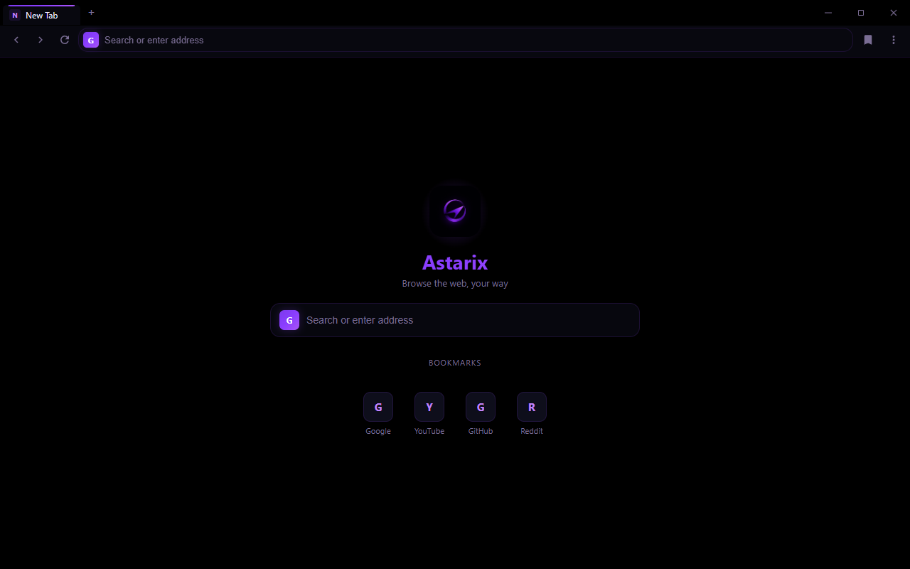
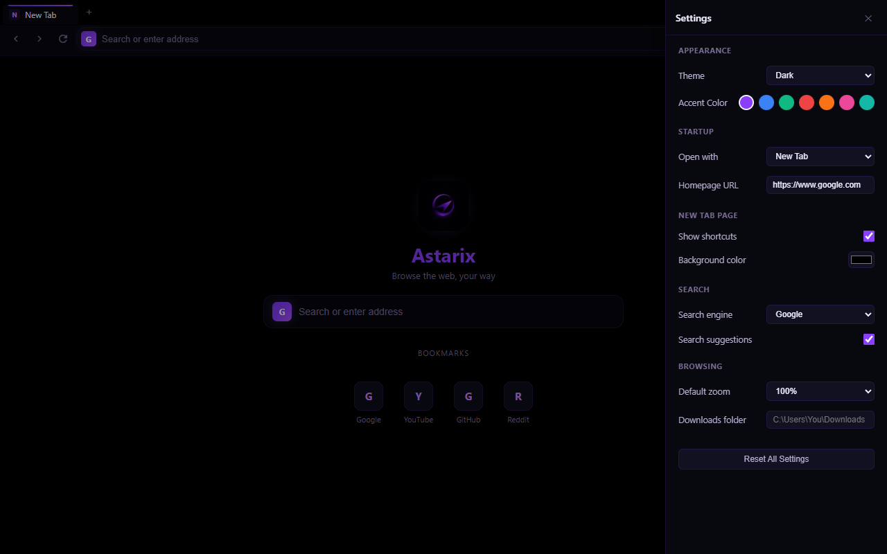

# Astarix Browser

[](https://github.com/mrlurix/astarix-browser/releases/latest)
[](LICENSE)
[](https://github.com/mrlurix/astarix-browser/releases/latest)
[](https://mrlurix.github.io/astarix-browser/)

A fast, private, and fully customizable desktop web browser for Windows — built on Electron 43 / Chromium 143. Browse the web, your way: dark or light theme, seven accent colors, three search engines, a personal start page, and zero telemetry.

🌐 **Website:** https://mrlurix.github.io/astarix-browser/
⬇️ **Download:** [Astarix-Browser-Portable.exe](https://github.com/mrlurix/astarix-browser/releases/latest/download/Astarix-Browser-Portable.exe) (portable, no install needed)





## Features

**Browsing**
- Multi-tab browsing with per-tab navigation, reload, and titles
- Smart omnibox: type a URL to go there, type anything else to search
- Three search engines (Google, Bing, DuckDuckGo) with live suggestions and one-click cycling
- Page zoom (30%–300%), keyboard shortcuts (`Ctrl+T/W/L/R/D`, `F12`), fullscreen mode
- Chrome-style right-click menu: back/forward/reload, cut/copy/paste, open link in new tab, copy link, save image, search selection, inspect

**New Tab page**
- One-click shortcuts from your bookmarks (or curated defaults)
- Custom background color, show/hide shortcuts

**Personalization**
- Dark and light themes, seven accent colors applied across the whole UI
- Startup choice: blank new tab or your own homepage URL
- Default zoom level, custom downloads folder, everything persisted locally

**Library**
- History (last 200 pages), bookmarks, and a download manager with progress states
- All data stays on your machine in localStorage — no account, no cloud, no telemetry

**Extensions**
- Load unpacked Chromium extensions from a folder
- Manifests are screened before loading: dangerous permissions (`nativeMessaging`, `debugger`, `proxy`, …), `<all_urls>` host access, and broad content-script matches are blocked

## Security model

Astarix is hardened on two fronts:

**Protecting you from the web**
- Renderer runs sandboxed with `contextIsolation`, no Node integration, and a strict Content Security Policy
- Sensitive permissions are denied by default: geolocation, camera/mic (`media`), notifications, USB/serial/HID/Bluetooth, clipboard-read, and display-capture
- Non-HTTP(S) navigation, redirects, popups (`allowpopups` removed), and `webview` sources are blocked; `will-attach-webview` strips preloads and locks down preferences
- Every download goes through a Save dialog; filenames are sanitized (no path traversal, no reserved Windows names)
- All user input (URLs, titles, suggestions, settings) is validated, length-capped, and HTML-escaped before rendering; `localStorage` data is schema-validated on load (prototype-pollution safe)

**Protecting the app from tampering**
- Production builds are obfuscated (`javascript-obfuscator`) and packaged with Electron Fuses: `RunAsNode` off, Node-options/CLI-inspect disabled, asar integrity validation on, app loads from asar only
- Remote debugging switches and site-isolation-disabling flags are blocked at startup

## Download

Grab the latest portable build from the [Releases page](https://github.com/mrlurix/astarix-browser/releases/latest):

- **Astarix-Browser-Portable.exe** (~90 MB) — just run it, no installation, no admin rights.

## Build from source

Requirements: [Node.js](https://nodejs.org/) 18+ and npm.

```bash
git clone https://github.com/mrlurix/astarix-browser.git
cd astarix-browser
npm install
npm start        # run in development mode
npm run build    # obfuscate + package -> build-staging/dist/Astarix-Browser-Portable.exe
```

> Note: if `npm install` skips Electron's postinstall (strict script policies), run `node install.js` inside `node_modules/electron` once to fetch the binary.

## Architecture

The renderer follows a **layered, React-Native-style architecture** — declarative
components, one-way data flow, and a single source of truth — with **zero runtime
dependencies** (no React/Virtual-DOM shipped to users).

```
astarix-browser/
├── main.js                 # Main process: window, menus, downloads, permissions,
│                           # anti-tamper switches, low-end resource tuning
├── preload.js              # Minimal context-bridge API
├── renderer/
│   ├── core/
│   │   ├── rn.js           # RN primitives: View / Text / Pressable / mount
│   │   ├── store.js        # Reactive store + emitter (batched notifications)
│   │   ├── config.js       # Engines, accents, limits, validators, persistence
│   │   ├── dom.js          # Lazy element registry (load-order independent)
│   │   ├── state.js        # Single source of truth + all actions
│   │   ├── ui.js           # Pure render functions (no side effects)
│   │   └── panels.js       # Panel/menu orchestration
│   ├── app.js              # Wiring only — events, subscriptions, boot
│   ├── index.html
│   └── styles.css
├── scripts/
│   ├── obfuscate.js        # Staging + JS obfuscation for production builds
│   └── after-pack.js       # Electron Fuse configuration
└── docs/                   # Project website (GitHub Pages)
```

**Data flow:** `app.js` wires events → actions in `core/state.js` mutate the store →
subscribers re-render the pure views in `core/ui.js`. Nothing else touches the DOM.

## Performance on weak systems

Astarix is built to stay usable on low-end PCs:

- **Automatic low-end profile** — on machines with ≤2 CPU cores or ≤4 GB RAM the app
  switches to a 384 MB heap, a 16 MB disk cache, a single raster thread and
  disables partial raster / back-forward cache / lazy-frame loading.
- **Performance mode** (⚙ Settings → Performance) — `Auto` / `On` / `Off`.
  When active it strips animations, backdrop blur, box shadows and the logo glow,
  which removes most GPU compositing work on integrated graphics.
- **Batched rendering** — store notifications are coalesced into one paint per tick.
- **Capped memory** — max 30 tabs, 200 history entries, 50 downloads, 100 bookmarks.
- **Lazy panels** — panel contents are rendered only when opened.
- **Spellcheck, component updates, sync and domain reliability** are disabled.

## Tech stack

- **Electron 43** · **Chromium 143** · HTML/CSS/JS (no framework)
- Build: `electron-builder` (portable target), `javascript-obfuscator`, `@electron/fuses`

## License

MIT — see [LICENSE](LICENSE).
